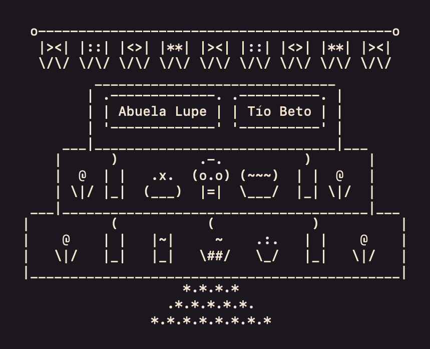
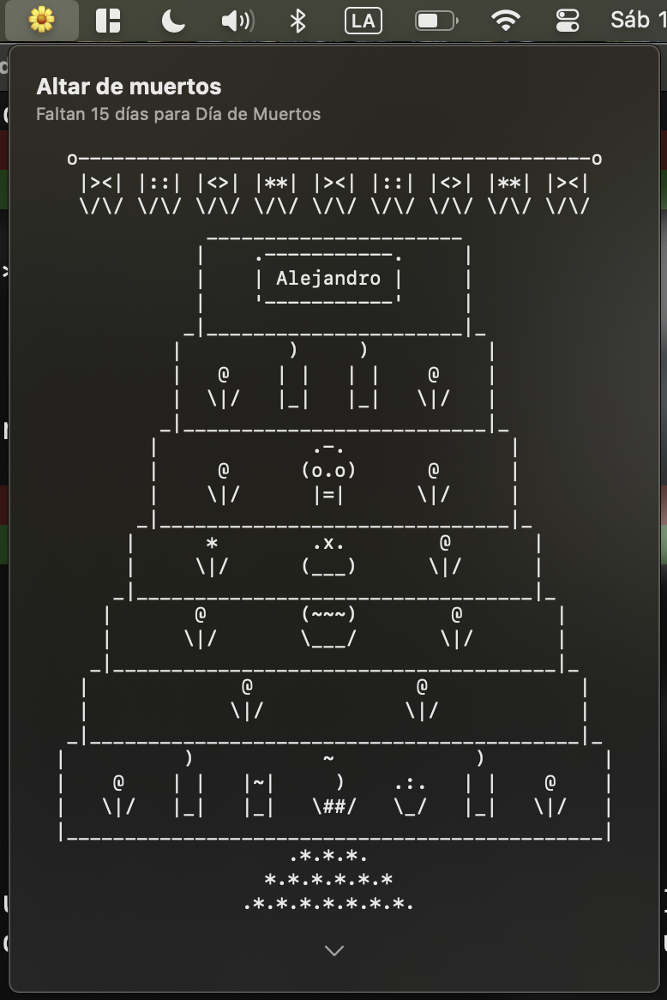
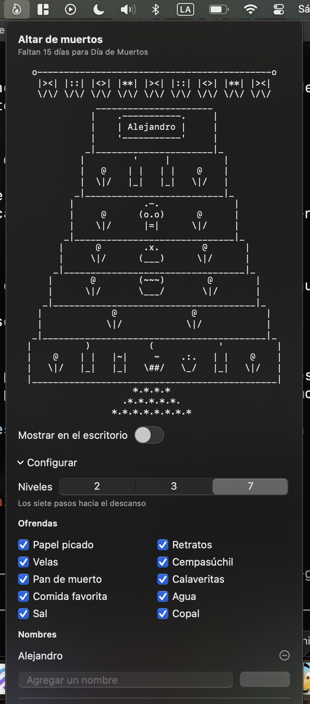
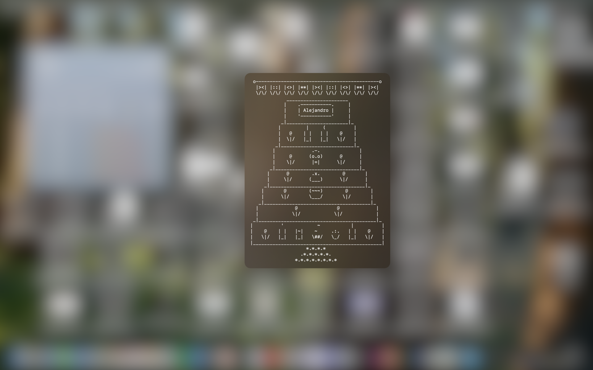

# Altar.app

Un altar de muertos dibujado en ASCII que vive en la barra de menú de la Mac, para honrar la memoria de tus seres queridos.

El Día de Muertos es una tradición mexicana que se celebra el 1 y 2 de noviembre, cuando se cree que las almas de los difuntos vuelven a visitar a sus familias. Une raíces indígenas con las fiestas católicas de Todos los Santos y los Fieles Difuntos: el día 1 se recuerda a los niños y el 2 a los adultos. Para recibirlos, en las casas se pone un altar con sus retratos, su comida favorita, velas que alumbran el camino y flores de cempasúchil, cuyo color y aroma los guían de regreso. No es un día de luto, sino de recordar con cariño a quienes ya no están. Desde 2008, la UNESCO la reconoce como Patrimonio Cultural Inmaterial de la Humanidad.



- **Niveles:** 2 (el cielo y la tierra), 3 (con el inframundo) o 7 (los siete pasos hacia el descanso).
- **Ofrendas:** papel picado, retratos con los nombres de tus seres queridos, velas, cempasúchil, pan de muerto, calaveritas, comida favorita, agua, sal y copal. Cada una se puede poner o quitar.
- **Animado:** las velas parpadean, el humo del copal sube y el papel picado se mueve con el viento. Se queda quieto si tienes activado "Reducir movimiento".
- **En el escritorio:** el altar también se puede dejar pegado al fondo del escritorio, detrás de las ventanas, y moverlo a donde quieras.
- **Cuenta regresiva** al 1 y 2 de noviembre.

## Cómo se ve

<table>
  <tr>
    <td align="center"></td>
    <td align="center"></td>
  </tr>
  <tr>
    <td align="center">El panel de la barra de menú</td>
    <td align="center">Configurando niveles, ofrendas y nombres</td>
  </tr>
</table>

<p align="center">
  
  <br>
  Como widget en el escritorio
</p>

## Instalar

1. Descarga `Altar-x.y.z.dmg` de la sección [Releases](../../releases).
2. Ábrelo y arrastra **Altar** a **Aplicaciones**.
3. Ábrela desde Aplicaciones y busca la flor de cempasúchil 🌼 en la barra de menú.

La app está firmada con Developer ID y notarizada por Apple, así que abre con doble clic, sin avisos.

Requiere **macOS 13 (Ventura) o más nuevo**, en una Mac con Apple Silicon o con Intel.

## Compilar

Solo se necesitan las Command Line Tools de Xcode (`xcode-select --install`); no hace falta Xcode ni SwiftPM.

```sh
tools/check.sh     # pruebas sin interfaz: el dibujo, el guardado y el calendario
tools/build.sh     # compila build/Altar.app, Universal y firmada ad hoc
```

`build.sh` no necesita certificado. Para publicar se necesita la cuenta de Apple Developer:

```sh
tools/package.sh           # DMG firmado con Developer ID y notarizado, para Releases
tools/package-appstore.sh  # .pkg con sandbox para la Mac App Store
```

El icono se genera con `tools/make-icon.swift` y se guarda en `Resources/AppIcon.icns`. El GIF de arriba lo genera `tools/make-gif.swift` con el mismo renderer que usa la app. Las instrucciones de los dos están al inicio de cada archivo.

## Cómo está hecho

- `Sources/AltarRenderer.swift`: convierte la configuración en líneas de texto. Es una función pura, así que la misma salida sirve para el panel, el escritorio y las pruebas.
- `Sources/Pieces.swift`: el arte ASCII de cada ofrenda y sus fotogramas de animación.
- `Sources/AltarApp.swift`: el icono y el panel de la barra de menú (`MenuBarExtra` con estilo `.window`).
- `Sources/FloatingPanel.swift`: el altar en el escritorio (un `NSPanel` sin borde, al nivel de los iconos).
- `Sources/AltarStore.swift`: guarda la configuración como JSON en `UserDefaults`.

## Licencia

MIT. Ver [LICENSE](LICENSE).
